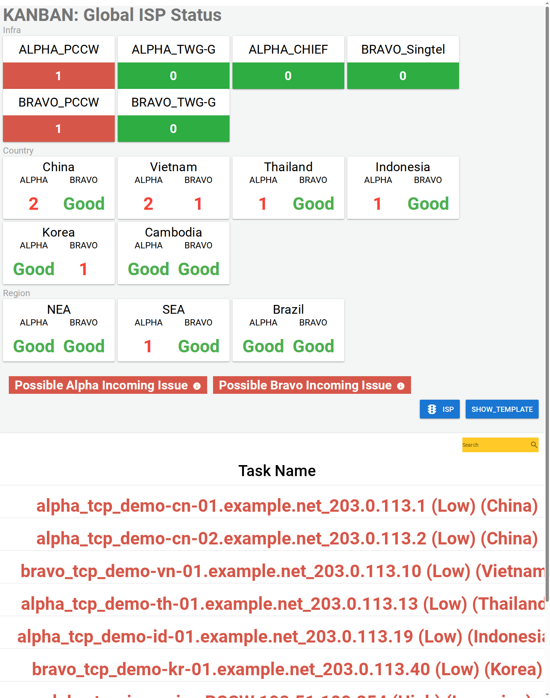
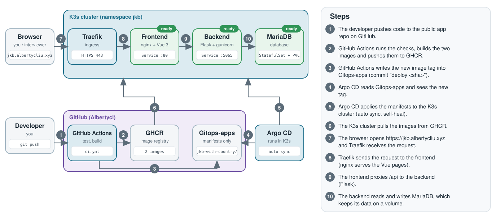

# Jkb-with-country

**Live demo:** https://jkb.albertycliu.xyz (made-up seed data, no login)

An ISP status board for a network operations team: one screen that shows which internet provider, in which country, has failing probes.



## What it does

- Shows a card for every ISP, country and region.
- Raises a "Possible Incoming / Outgoing Issue" banner. Per ISP group, one failing check means incoming, two or more means outgoing. Click the banner to see why.
- The demo runs on made-up seed data. The real monitoring feeds are switched off with one setting (`ENABLE_POLLERS=false`).

## How it works



Code goes to GitHub, GitHub Actions builds the images and updates the [Gitops-apps](https://github.com/Albertycl/Gitops-apps) repo, and Argo CD deploys the change to a K3s cluster by itself.

## SRE skills this shows

- **GitOps and CI/CD:** GitHub Actions, GHCR, Argo CD with auto sync and self-heal.
- **Rollback:** `git revert` of the "deploy" commit in Gitops-apps.
- **Containers:** non-root backend, container health checks, Docker Compose.
- **Configuration:** all settings come from environment variables, no secrets in Git, and a feature flag for the external feeds.
- **Kubernetes:** StatefulSet with a volume, Traefik ingress, readiness probes.

## Run it locally

```bash
cp .env.example .env     # set MYSQL_PASSWORD
docker compose up --build
```

Then open `http://<server-ip>:5436`. The compose file needs a MariaDB container on the Docker network `netdiag_default` (setup commands are in the [full details](docs/DETAILS.md)).

## More

[Full details](docs/DETAILS.md): install on Kubernetes, CI/CD, monitoring and known limits.
